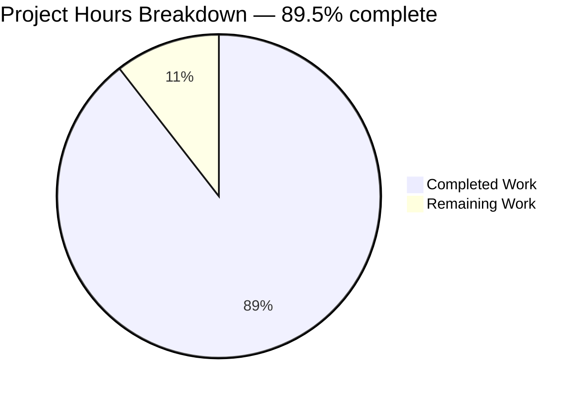
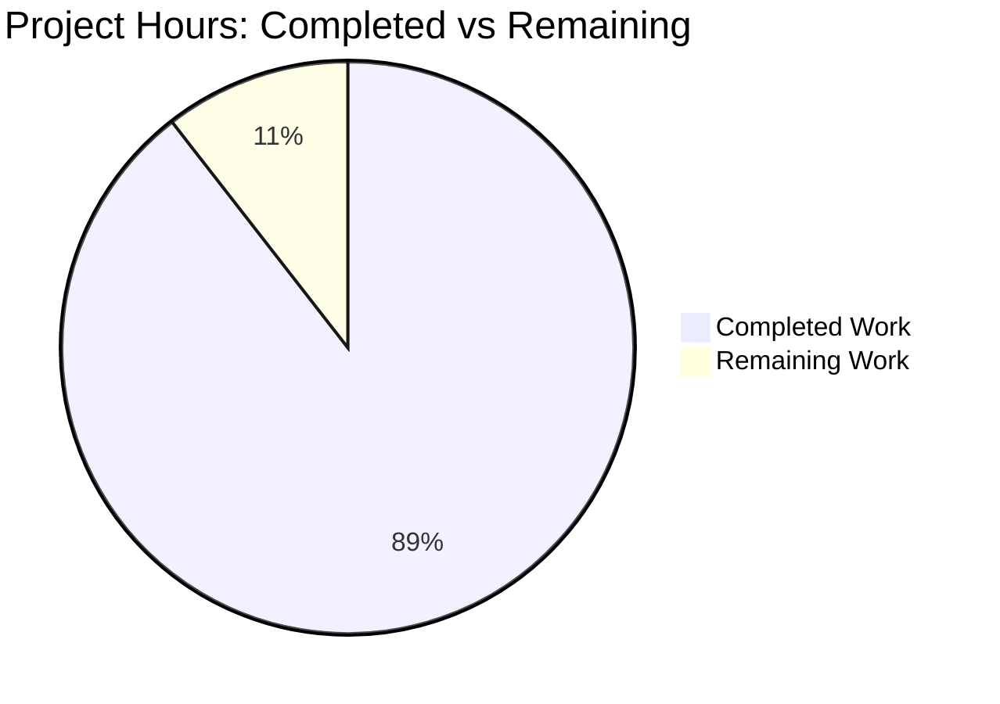

# 1. Executive Summary

## 1.1 Project Overview

A self-contained Node.js tutorial that starts an HTTP server exposing one endpoint — `GET /hello` — which answers the calling client with the plain-text body `Hello world`. It teaches how Node turns a request into a response, and doubles as a dependency-free skeleton for a small service. Six files, 580 lines, no packages and no build step: `app.js` holds the route and its framing, `server.js` the process concerns, `test/hello.test.js` four behavioural cases, `README.md` the tutorial, with `package.json` and `.gitignore` completing the tree.

## 1.2 Completion Status



| Metric | Hours |
|---|---|
| Total Hours | 38.0 |
| Completed Hours (AI + Manual) | 34.0 |
| Remaining Hours | 4.0 |
| Completion | 89.5% |
| Colour key | Completed Work — Dark Blue `#5B39F3`; Remaining Work — White `#FFFFFF` |

Completion = 34.0 ÷ (34.0 + 4.0) = **89.5%**. Hours cover only what this project was scoped to deliver plus the path-to-production work outstanding; all eight functional requirements are delivered and verified.

## 1.3 Key Accomplishments

- ✅ `GET /hello` answers `200 OK` with an explicit content type, `Content-Length: 11` and a byte-exact body.
- ✅ A query string cannot change the answer, and every other request target answers `404 Not Found`.
- ✅ Every method other than `GET` and `HEAD` answers `405` with `Allow: GET, HEAD`; `HEAD /hello` returns the same headers with no body.
- ✅ `npm start` prints one line naming the bound URL; `npm test` runs four behavioural cases on an ephemeral port.
- ✅ `HOST` and `PORT` override the documented defaults, every failure prints one readable sentence and exits 1, and the project runs from the Node runtime alone with zero dependencies.

## 1.4 Critical Unresolved Issues

Four items are open. Counted against the six planned deliverables and the eight functional requirements, none is incomplete — 0 of 6, 0 of 8 — and every open item is a non-blocking follow-up.

| Issue | Impact | Owner | ETA |
|---|---|---|---|
| `HEAD /hello` and the unparsable-target `400` have no automated regression guard: the suite asserts only the four specified cases | A future edit to the 200 write path could drop the HEAD response without failing the gate | Maintainer | 0.5 h |
| The tutorial states the code runs unchanged on the Node 22, 24 and 26 LTS lines; only the 22 line has been exercised | A published compatibility statement rests on Stability 2 API usage and the manifest floor rather than on a run | Maintainer | 2 h |
| The `CONNECT` refusal answers the method-level `405` for authority-form targets, where the path-first rule would give `404` (accepted difference — see 5.2) | A reader comparing raw `CONNECT` traffic against the `404` boundary sees a deliberate difference | Maintainer | Decision only, 0 h |
| The refusal's socket `'error'` guard is reachable only by a peer that resets the connection | An abnormal-peer path has no automated assertion | Maintainer | 0 h |

## 1.5 Access Issues

No access issues identified. The project needs no credential, service, database or permission beyond the checkout: it declares no dependency, calls nothing outbound and runs from the Node runtime alone.

## 1.6 Recommended Next Steps

1. **[High]** Clone cleanly, run the documented command sequence as written, and read `README.md` start to finish as a new reader — 1 h.
2. **[High]** Spot-check the boundaries and failure paths on that clone — `HEAD /hello`, `GET //`, the `CONNECT` refusal, a taken port, an invalid `PORT` — 0.5 h.
3. **[Medium]** Confirm the Node 24 and 26 compatibility statement, correcting the tutorial if it differs — 2 h.
4. **[Low]** Decide whether the two unasserted boundary behaviours gain assertions, and keep the tutorial's test summary in step — 0.5 h.

# 2. Project Hours Breakdown

## 2.1 Completed Work Detail

| Component | Hours | Description |
|---|---|---|
| Manifest and repository hygiene (`package.json`, `.gitignore`) | 2.0 | The manifest's seven keys — name, version, one-line description, `private`, `type: module`, the `engines` floor and the `start`/`test` scripts — with every dependency field deliberately absent; the ignore file's three required patterns plus the generated lockfile the optional install writes. |
| HTTP application — route, framing and boundaries (`app.js`) | 8.0 | The single body constant, the one framing helper that sets the content type and a byte-accurate length and ends the response exactly once, parse-then-route on the parsed path, the `200`/`404`/`405`/`400` branches, `HEAD` sharing the `200` branch, the connection-layer `CONNECT` refusal, the `createServer()` factory, and the comments that state the reasons a reader would otherwise guess. |
| Process entry point — configuration, binding, failure and shutdown (`server.js`) | 8.0 | The two environment reads with their documented defaults and empty-value handling, the digits-only port guard and its sentence, the `'error'` listener whose sentence names the stage the failure happened in, the single startup line reporting the address and port actually bound, and the signal handlers with their repeat-signal fast path. |
| Behavioural test suite (`test/hello.test.js`) | 5.0 | The factory-driven lifecycle that binds port `0` on loopback and closes its own server, and the four cases with their asserted values — the contract and its framing, the ignored query string, the `404` boundary, and the `405` with `Allow` including the two raw-socket `CONNECT` probes. |
| Tutorial (`README.md`) | 7.0 | The teaching material: prerequisites, optional install, run with the startup line and both overrides, the `curl` exercise with its exact expected response and the boundary checks, the test command, how a request becomes that response, and where a second route goes. |
| Acceptance and boundary verification | 4.0 | The documented command sequence executed end to end against the running program, the boundary battery, the process failure and shutdown runs, and each documented value confirmed against what the program actually answers. |
| **Total** | **34.0** | |

## 2.2 Remaining Work Detail

| Category | Hours | Priority |
|---|---|---|
| Independent acceptance pass: run the documented sequence on a clean clone and read the tutorial start to finish as a first-time reader | 1.5 | High |
| Runtime-compatibility confirmation on the Node 24 and 26 LTS lines the tutorial names | 2.0 | Medium |
| Regression-coverage decision for the two boundary behaviours the suite deliberately leaves unasserted | 0.5 | Low |
| Maintainer decision on the two accepted differences recorded in Section 5.2 — how strict the port guard should stay, and how broadly the `CONNECT` refusal should apply if a second route is ever added | 0.0 | Low |
| **Total** | **4.0** | |

The last row carries no engineering hours: both items are decisions a maintainer records, and neither changes what ships today. It is listed so that every difference recorded in Section 5.2 has a named owner rather than sitting unacknowledged.

## 2.3 How These Hours Were Estimated

Completed hours were estimated per deliverable from what each file actually contains — its lines, its branches, the cases it asserts and the documentation it carries — and each is traceable to a specific requirement of the plan. Remaining hours were estimated from the path-to-production needs above, each traceable to a statement the project makes about itself: a compatibility claim the tutorial publishes, an acceptance pass a reader-facing deliverable warrants, and a coverage decision the plan deliberately leaves open.

| Measure | Value |
|---|---|
| Completed hours (Section 2.1 total) | 34.0 |
| Remaining hours (Section 2.2 total) | 4.0 |
| Total project hours | 38.0 |
| Completion | 34.0 ÷ 38.0 = 89.5% |

Confidence is high for the completed work, because each component's scope is fixed by the plan and its state was confirmed by running the program; it is medium for the remaining work, because the runtime-compatibility confirmation can conclude either way — the code uses only Stability 2 APIs, so a second LTS line is expected to agree, but the check is what settles it.

# 3. Test Results

The project ships one automated suite, run by `npm test` (= `node --test`) from the repository root. Its four cases are executed against a real server on an ephemeral loopback port, driven by the runtime's own HTTP client, so each result below is an executed behavioural check rather than a static one.

| Area / Category | Framework | Tests | Passed | Failed | Coverage | What This Proves |
|---|---|---|---|---|---|---|
| Endpoint contract and response framing | `node:test` (`node --test`) | 1 | 1 | 0 | No coverage tool is adopted | `GET /hello` answers `200` with the stated content type, a byte-accurate `Content-Length` and the body byte-for-byte, so a client can rely on the response as published. |
| Query-string handling | `node:test` | 1 | 1 | 0 | No coverage tool is adopted | The answer depends on the path alone, so a caller may append a query string without changing what comes back. |
| Endpoint boundary (`404`) | `node:test` | 1 | 1 | 0 | No coverage tool is adopted | The match is exact: an unknown path and the trailing-slash variant both answer `404`, so the boundary is a documented contract rather than an accident. |
| Method boundary (`405` with `Allow`) | `node:test` | 1 | 1 | 0 | No coverage tool is adopted | Every method other than `GET` and `HEAD` is refused explicitly with `Allow: GET, HEAD` — including `CONNECT`, asserted over raw sockets in both its origin and authority forms — so no unsupported verb is dropped silently. |
| **Total** | | **4** | **4** | **0** | | |

Observed totals: `npm test` reports `1..4`, `# tests 4`, `# pass 4`, `# fail 0`, `# cancelled 0`, `# skipped 0` and exit status 0 in about 133 ms; the focused run `node --test test/hello.test.js` reports the same four of four in about 127 ms. The suite binds port `0`, so it never collides with a server you already have running, and it starts and closes its own server, so it needs no configuration file and leaves no listener behind. The static gate that accompanies it — `node --check` on each of the three JavaScript files — exits 0 with no output.

**Not Covered.** These behaviours are implemented and were exercised by hand against the running server, but nothing in the automated suite asserts them:

- `HEAD /hello` — the same status and headers with the body suppressed. It shares the `200` branch deliberately and is proved by a direct request rather than by an assertion, so a future edit to the write path could remove it without failing the gate.
- The `400 Bad Request` branch for a target that cannot be parsed (`GET //`). It is a safety net that ordinary malformed input never reaches, because the runtime's own parser rejects a malformed request line first.
- The socket `'error'` guard inside the `CONNECT` refusal. It is reachable only by a peer that resets the connection, so no ordinary run exercises it.
- The process surface in `server.js` — the environment reads, the startup line, the three failure sentences and the signal handlers. The suite imports the application factory rather than spawning the entry point, so a regression in the process layer passes the gate untouched. A human should run `npm start`, `PORT=abc npm start` and a second instance on a taken port, then press Ctrl-C, before release.
- The documentation itself. No test can assert prose; a human should follow `README.md` from start to finish against a running server.
- Runtime breadth: the compatibility statement the tutorial makes covers the Node 22, 24 and 26 LTS lines, and only the 22 line has been executed here. A human should run the suite on one other line before treating that statement as proved.
- Style, framing invariants and dependency hygiene have no automated gate either, because the project adopts no linter, formatter, type checker or dependency auditor. Keeping `node --check` plus the suite in the review habit is the whole automated evidence, and it is currently green.

# 4. Runtime Validation & UI Verification

The running application was driven directly: the entry point was started on a private port, every documented flow and boundary was exercised over HTTP and over raw sockets, and the process lifecycle was exercised with signals and deliberately failing configurations.

- ✅ **Start-up** — `npm start` (equivalently `node server.js`) prints exactly one line naming the bound URL and the route to try, byte-identical to the line the tutorial publishes; standard error stays empty.
- ✅ **Primary journey** — `GET /hello` answers `200 OK`, `Content-Type: text/plain; charset=utf-8`, `Content-Length: 11`, and a body byte-identical to `Hello world` with no trailing newline (verified with a byte comparison, exit 0, and an 11-byte count).
- ✅ **Query string** — `/hello?name=Ada` returns the identical eleven bytes, so the answer depends on the path alone.
- ✅ **Request-target boundary** — `/nope`, `/hello/` and `/` each answer `404 Not Found`; `GET //` answers `400 Bad Request`; `HEAD /hello` answers `200` with the same headers and an empty body.
- ✅ **Method boundary** — `POST`, `PUT`, `PATCH`, `DELETE`, `OPTIONS` and `TRACE` on `/hello` each answer `405` with `Allow: GET, HEAD`; `CONNECT` in both its origin and authority forms receives the same complete `405` reply on a raw socket, after which the connection closes.
- ✅ **Configuration overrides** — `PORT=8080` serves on the documented override; `PORT=0` prints the port the operating system chose and serves on it; `HOST=localhost` binds the IPv6 loopback, prints the bracketed URL and serves by that name; `HOST=0.0.0.0` prints the wildcard address it actually bound and serves.
- ✅ **Failure paths** — an unusable `PORT` and a port already in use each print exactly one sentence on standard error, leave standard output empty, exit with status 1, and produce no stack trace; an address the machine cannot bind is reported the same way.
- ✅ **Shutdown** — `SIGINT` and `SIGTERM` each exit with status 0, print nothing to standard error, and release the listening port; a second signal exits immediately.
- ✅ **External integrations** — none exist: the product calls nothing outbound, reads no remote configuration, accepts no credential and depends on no service, so there is no integration to drive and no unverified third-party surface.
- ⚠ **User interface** — none exists. The product's only user-facing surface is the HTTP response, read here with `curl`, with raw sockets and by counting bytes. There is no page, template, static asset or script anywhere in the project, and a browser's automatic favicon request is answered by the ordinary `404` boundary.

**Never exercised at runtime.** Four areas were not driven in this environment, and each should be treated as unproven by anything other than reading: the behaviour on the Node 24 and 26 LTS lines the tutorial names, because only the Node 22 line is available and another line cannot be installed here; the socket `'error'` guard inside the `CONNECT` refusal, which needs a peer that resets the connection mid-reply; a genuine accept failure on the post-bind error path, where the exact event the runtime emits was injected because the operating system sheds that condition silently; and any behaviour on a non-Linux host, in a container, or under a process manager — none of which the project targets or ships configuration for.

# 5. Compliance & Quality Review

## 5.1 Compliance Matrix

| Deliverable | What It Holds To | Status | Progress |
|---|---|---|---|
| `package.json` | The plan's exact field list, with every dependency field absent and no `main`/`exports` | ✅ Pass | 100% |
| `.gitignore` | The three enumerated patterns plus the generated artifact of the optional install | ✅ Pass | 100% |
| `app.js` — route and response contract | One endpoint at `/hello`, byte-exact body, explicit and byte-accurate framing headers, one response end per path | ✅ Pass | 100% |
| `app.js` — request and method boundaries | `404` for every other target, `405` with `Allow: GET, HEAD` for every other method, `400` for an unparsable target, `HEAD` sharing the `200` branch | ✅ Pass | 100% |
| `app.js` — connection-layer refusal | Every `CONNECT` answered with the contract's `405` rather than dropped (one accepted difference, D1) | ✅ Pass | 100% |
| `server.js` — configuration and binding | Documented `HOST`/`PORT` defaults with overrides, loopback by default, one startup line naming the address actually bound | ✅ Pass | 100% |
| `server.js` — failure and shutdown | No unhandled failure path: one readable sentence and exit 1 on every failure, exit 0 on either signal, no stack trace | ✅ Pass | 100% |
| `test/hello.test.js` | Four behavioural cases over real HTTP on an ephemeral port, discovered and run with no configuration | ✅ Pass | 100% |
| `README.md` | Every content item the plan specifies, in the plan's teaching order, with the acceptance block reproduced and every documented command true | ✅ Pass | 100% |
| Delivery shape | Zero declared dependencies, no build step, no test configuration, runs and tests from the runtime alone | ✅ Pass | 100% |
| Security posture | A constant response interpolating no input, the request target parsed inside `try`/`catch`, a loopback default bind, no secret or credential anywhere | ✅ Pass | 100% |
| Out-of-scope discipline | Nothing built, promised or stubbed outside the plan: no container, pipeline, deployment, persistence, auth, TLS, rate limiting, metrics, extra route, linting or coverage tooling | ✅ Pass | 100% |

## 5.2 AAP & Rule Divergences and Gaps

No user-specified rules were ever supplied for this project, so nothing departs from a rule. Six differences from the Agent Action Plan exist, all deliberate, all with no impact on correctness, security, performance or delivery, and none blocking release.

| What the AAP/Rule Required | What Was Delivered Instead | Why It Diverged | Impact | Remediation |
|---|---|---|---|---|
| Pathname is matched before the method, and every target that is not exactly `/hello` answers `404` (0.5.3) | A `CONNECT` target — an authority, not a path — answers the method-level `405` with `Allow: GET, HEAD` (`app.js:113-134`, registered at `app.js:151`) | Node delivers `CONNECT` at the connection layer, below the request listener, so no path-based routing can reach it; the plan's own method rule requires every unsupported method to be refused explicitly | Narrow: for `CONNECT` alone the method answer precedes the path answer | None. Re-scope the refusal if a second route is ever added (D1) |
| `server.js` depends on `node:http`, `./app.js` and the `process` global (0.5.1) | It also imports `isIPv6` from `node:net` (`server.js:14`) to bracket an IPv6 address in the published URL | The startup line must name a URL a client can dial, and an unbracketed IPv6 address is not one | None: a runtime built-in, no package and no dependency field added | None (D2) |
| The test depends on `node:test`, `node:assert/strict`, `node:events`, global `fetch` and `../app.js` (0.5.1) | It also imports `connect` from `node:net` (`test/hello.test.js:4`) for two raw-socket `CONNECT` probes, and case 4 asserts the status line, `Allow`, content type, `Content-Length` and body in addition to the enumerated values | `fetch` cannot issue a `CONNECT`; a raw socket is the only way to assert the method boundary for that verb | None: no package added, the suite still reports four cases | None (D3) |
| `.gitignore` contains `node_modules/`, `npm-debug.log*` and `.DS_Store` (0.5.1) | Those three verbatim, plus `package-lock.json` and one explanatory comment line | The same sentence requires that an optional install cannot dirty the tree, and with a zero-dependency manifest the lockfile is that install's only artefact | None: no required pattern removed, nothing else matched | None (D4) |
| `PORT` is parsed with `Number(...)` (0.5.1) | The guard accepts only plain decimal digits within range (`server.js:70`), so `1e3`, `0x10`, `+3000`, `3000.0` and padded values are refused with the one failure sentence | `Number` silently converts those forms into a port the operator did not intend (`1e3` → 1000, `0x10` → 16); binding the wrong port silently is worse than refusing readably | None for any documented form: the default, any explicit `PORT`, `PORT=0`, zero-padded values and every `HOST` form behave as documented | None (D5) |
| Exactly two messages exist: the startup line on stdout and the port-in-use sentence on stderr (0.11.1) | Exactly two logging call sites (`server.js:59`, `:109`); the stderr sentence's reason changes with the failure, so three sentences are reachable — unusable `PORT`, port in use, any other bind error | The plan also requires that no failure path be left unhandled and that every failure write to standard error; without the guard an unusable `PORT` reaches the bind as a `RangeError` and exits with a stack trace | None functional: no request log, no levels, no structured fields; the plan's count governs the ordinary path | None (D6) |

**D1 — the `CONNECT` refusal answers before the path rule.** The refusal lives at the connection layer because that is where Node hands `CONNECT` over: the request listener never sees it, and its target is an authority (`evil.example:443`) or an origin form, not a path, so nothing can be routed against `/hello` or anything else. Both wire forms receive a complete reply — status line, `Allow: GET, HEAD`, content type, a byte-accurate length, `Date` and `Connection: close` — and then the connection closes. The difference from the plan shows only if you compare raw `CONNECT` traffic against the `404` boundary: `/nope` answers `404` over `GET` and `405` over `CONNECT`. Nothing needs doing now. If a second route is added, re-scope the refusal so an unknown path follows the path answer and the authority form stays refused.

**D5 — the port guard is stricter than a `Number` parse.** `Number('1e3')` is 1000, `Number('0x10')` is 16 and `Number(' 80 ')` is 80, so a parse taken literally would bind a port nobody asked for, on a privileged range in one case. The delivered guard (`server.js:70`) accepts only plain decimal digits between 0 and 65535, refuses everything else with a single readable sentence and exit code 1, and still accepts every documented form — the default 3000, any explicit port, `PORT=0` and zero-padded values. A reader who passes an undocumented form such as `PORT=+8080` gets the refusal sentence rather than a successful bind. Decide whether that strictness is what you want published; if you would rather accept those forms, widen the guard and state the accepted set in the tutorial in the same change.

**D6 — one failure message, three sentences.** The plan fixes the logging surface at two messages and names only the port-in-use sentence. The delivered process indeed has two call sites, but its stderr sentence completes differently depending on where the failure happened: an unusable `PORT` value, a port already in use, and any other bind failure. The reason is a conflict inside the plan itself — its no-unhandled-failure rule forbids leaving those paths silent, and without the guard an unusable `PORT` reaches the bind as a runtime error that exits with a stack trace, which is exactly what the failure handling exists to prevent. The count still governs: no request log, no levels, no structured fields. Nothing needs doing; if you want the plan's wording literally, the three sentences can be collapsed into one, but not at the cost of a silent failure path.

# 6. Risk Assessment

Every risk below is forward-looking: what could still go wrong once this code is in the hands of a reader or a maintainer.

| Risk | Category | Severity | Probability | Mitigation | Status |
|---|---|---|---|---|---|
| Two boundary behaviours — `HEAD /hello` and the unparsable-target `400` — have no automated regression guard, so a future edit to the write path could remove one without failing the gate | Technical | Medium | Medium | Run both checks by hand before release, or revisit the deliberate decision to keep the suite at its four specified cases | Open, accepted |
| The `CONNECT` refusal writes its own bytes rather than using the runtime's response machinery, so a future change to the contract's framing headers must be mirrored in both paths (`app.js:38-47` and `app.js:113-134`) | Technical | Low | Medium | Keep the two header sets adjacent in review and re-verify the refusal over a raw socket whenever either changes | Open |
| The tutorial states the code runs unchanged on the Node 22, 24 and 26 LTS lines, and only the 22 line has been exercised | Technical | Low | Medium | Run the suite on one other LTS line before treating the statement as proved, and correct the tutorial if it differs | Open |
| No static tooling exists by design — no linter, formatter, type checker or coverage gate — so the suite plus `node --check` is the entire automated evidence | Technical | Low | Medium | Keep `node --check` and the focused suite run in the review habit; adding tooling would be a scope change, not a repair | Open, accepted |
| The documented `HOST=0.0.0.0` opt-in exposes the endpoint on every interface with nothing authenticating a caller | Security | Low | Low | Loopback is the default and the tutorial states the widening explicitly; keep the bind on loopback unless exposure is intended | Open, accepted |
| A peer that opens a connection and never completes its request line delays the first Ctrl-C until it goes away; the listener is released immediately | Operational | Low | Medium | Press Ctrl-C again to exit at once, or stop the process with `SIGTERM` | Open, documented |
| A signal delivered in the first few milliseconds of start-up, before the handlers are installed, ends the process with the operating system's default disposition and prints nothing | Operational | Low | Low | None required: nothing is bound and nothing is left in a bad state | Open |
| Under `npm start` the shell sees npm's own exit status (130) when the terminal is interrupted, even though the server process exits 0, and npm prints its own script banner first | Operational | Low | Medium | Run `node server.js` when the shell's exit status matters | Open |

**No integration risk surface exists.** The product calls nothing outbound, reads no remote configuration, accepts no credential, depends on no external service, database, queue or proxy, and ships no integration configuration. There is consequently no untested third party, missing key, network dependency or vendor outage to own — the only runtime dependency is the Node line recorded in `package.json`.

# 7. Visual Project Status



Colour key: **Completed Work** — Dark Blue `#5B39F3`; **Remaining Work** — White `#FFFFFF`.

**Completion: 89.5%** — 34.0 of 38.0 project hours complete, 4.0 remaining. Every functional requirement the request named is delivered; the remaining hours are the acceptance, compatibility and coverage follow-ups listed in Section 2.2.

**Remaining work by priority.** The four hours that remain are follow-up work rather than unfinished delivery, and they distribute by priority as follows.

| Priority | Remaining Hours | Where It Sits |
|---|---|---|
| High | 1.5 | The independent acceptance pass on a clean clone, and the boundary and failure-path spot-check on that same clone |
| Medium | 2.0 | Confirming the runtime-compatibility statement on the Node 24 and 26 LTS lines |
| Low | 0.5 | The regression-coverage decision for the two unasserted boundary behaviours |
| **Total** | **4.0** | |

**Remaining work by category.** The same four hours split across three categories: acceptance (1.5), runtime compatibility (2.0) and coverage decision (0.5). Nothing in the delivered surface — the endpoint, its boundaries, the process lifecycle or the documentation — carries unfinished work.

**Delivered volume.** Six files and one directory, 580 lines in total: `app.js` 154, `server.js` 134, `test/hello.test.js` 108, `README.md` 164, `package.json` 14, `.gitignore` 6 — with zero dependencies and no build step.

# 8. Summary & Recommendations

**What was delivered and verified.** The project is complete as specified: a dependency-free Node.js tutorial that serves exactly one endpoint, `GET /hello`, answering the calling HTTP client with the plain-text body `Hello world`. All six planned files are present — the HTTP application, the process entry point, the behavioural suite, the tutorial, the manifest and the ignore file — and every documented behaviour was exercised against the running program rather than read off the page. The response contract holds byte for byte; the query string cannot change it; the `404` boundary, the `405` refusal with `Allow: GET, HEAD`, the `400` branch and the `HEAD` suppression all behave as documented; the process reports its failures in one readable sentence and exits 1 instead of leaving a stack trace; and Ctrl-C is a clean stop. The automated suite passes four of four with no configuration and no leftover listener.

**Completion.** 34.0 of 38.0 project hours are complete, giving an AAP-scoped completion of **89.5%**. The eight functional requirements the request names are all delivered; the four hours that remain are a path-to-production tail — an independent acceptance pass on a clean clone (1.5 h), confirming the tutorial's Node 24 and 26 compatibility statement (2.0 h) and deciding whether the two deliberately unasserted boundary behaviours gain coverage (0.5 h). Nothing in the delivered surface carries unfinished work.

| Measure | Value |
|---|---|
| Functional requirements delivered | 8 of 8 |
| Planned deliverables delivered | 6 of 6 |
| Automated suite | 4 cases, 4 passed, 0 failed, exit 0 |
| AAP-scoped completion | 89.5% (34.0 ÷ 38.0 hours) |
| Open follow-ups | 4, none blocking |

**Gaps and the critical path.** The path to release is short and is a verification path, not a development one. First, clone the repository cleanly, run the documented sequence exactly as written and read the tutorial as a first-time reader would; that is the one check that tests the project as a product rather than as code, and it takes about an hour. Second, on that same clone, spot-check the boundaries and failure paths — `HEAD /hello`, `GET //`, the `CONNECT` refusal, a taken port and an unusable `PORT` — because those are deliberately outside the automated gate. Third, settle the runtime-compatibility statement by running the suite on another LTS line, since the tutorial publishes a claim only the 22 line can currently support.

**Risk posture.** Residual risk is low and concentrated in coverage and in published claims rather than in behaviour. The two sharpest points are that a future edit could remove the `HEAD` response or the `400` branch without failing the suite, and that the `CONNECT` refusal writes its own bytes, so its framing headers must be changed in two places. Neither is a defect in what ships. The security surface is correspondingly small: a constant response interpolating no input, a loopback default bind, no credential anywhere, and the only deliberate exposure choice documented and opt-in.

**Production-readiness assessment.** Ready to hand over, with the four follow-ups above recorded rather than hidden. As a teaching artifact it does what the request asked: the endpoint answers exactly as specified, the tutorial can be followed start to finish with nothing installed but Node, the failure and shutdown paths behave the way the documentation says, and the suite proves the contract over real HTTP instead of inspecting code. Recommended sequence for the maintainer: the acceptance pass and the boundary spot-check, then the runtime-compatibility confirmation, then the coverage decision — about four hours in total, after which the project can be treated as production-ready for its intended use.

# 9. Development Guide

## 9.1 System Prerequisites

- **Node.js 22 or later.** The manifest records the floor as `"engines": { "node": ">=22" }`, and every module the project uses is a Stability 2 API of the runtime. Verify with:

```bash
node -v          # v22.x or later
npm -v           # ships with Node.js
```

- **npm**, which ships with Node.js, for the two scripts the manifest defines.
- **A bash-like shell** (`bash` or `zsh`) for the optional byte-exactness check, which uses process substitution. Every other command in this guide works in any POSIX shell.
- Nothing else: no database, cache, message broker, container or container runtime.

## 9.2 Environment Setup

There is nothing to configure before starting. The project has no `.env` file, no configuration loader, no virtual environment to activate and no service to launch. The only configuration is two environment variables the process reads itself:

| Variable | Default | Accepted Values | Effect |
|---|---|---|---|
| `HOST` | `127.0.0.1` | a host name or an IP address; empty means "not set" | The bind address. Loopback by default, so the server is not reachable from the network unless you ask for it. `HOST=0` is not "no host" — it resolves to `0.0.0.0` and binds every interface. |
| `PORT` | `3000` | plain decimal digits between 0 and 65535; empty means "not set" | The listening port. `PORT=0` asks the operating system for a free port, and the start-up line prints the one it chose. |

Pass them on the same command line as the command — `PORT=8080 npm start` — so the value reaches the process environment rather than a shell variable alone.

## 9.3 Dependency Installation

None is required. The manifest declares no dependencies at all, so the project runs and tests from the Node runtime alone:

```bash
npm ls --depth=0     # nodejs-hello-tutorial@1.0.0 … └── (empty)   → exit 0
```

`npm install` is optional and safe: with no dependency declared it fetches nothing and writes only the generated `package-lock.json`, which the ignore file already excludes. Skip it entirely if you prefer a tree that stays exactly as cloned. If you later add a package, the registry is reachable, and `node_modules/` is already ignored.

## 9.4 Application Startup

Run from the repository root:

```bash
npm start                        # or, identically: node server.js
```

The process prints one line and keeps running:

```text
Listening on http://127.0.0.1:3000 — GET /hello returns "Hello world"
```

Stop it with Ctrl-C: the listener closes and the process exits with status 0. One process binds exactly one port, so a second instance needs a different port:

```bash
PORT=8080 npm start                 # http://127.0.0.1:8080/hello
PORT=0 npm start                    # let the OS pick a free port; the line prints it
HOST=localhost PORT=8080 npm start  # bind the address localhost resolves to
HOST=0.0.0.0 PORT=8080 npm start    # bind every interface (reachable from the network)
```

## 9.5 Verification Steps

Run these in order; each one is the acceptance path for the piece it checks.

```bash
# 1. Static gate — syntax only, exit 0 with no output for each file
node --check app.js && node --check server.js && node --check test/hello.test.js

# 2. The whole suite — four cases on an ephemeral port, no configuration needed
npm test                                  # 1..4 / # tests 4 / # pass 4 / # fail 0 → exit 0
node --test test/hello.test.js            # the focused run, ~130 ms

# 3. Start the server in one terminal, then exercise it from another
npm start
```

```bash
# 4. The contract, byte-exact
curl -i http://127.0.0.1:3000/hello
#   HTTP/1.1 200 OK
#   Content-Type: text/plain; charset=utf-8
#   Content-Length: 11
#   (blank line)
#   Hello world        <- no trailing newline; the shell prompt follows on the same line

curl -s http://127.0.0.1:3000/hello | cmp - <(printf 'Hello world')   # no output, exit 0
curl -s http://127.0.0.1:3000/hello | wc -c                            # 11
```

```bash
# 5. The boundaries
curl -si "http://127.0.0.1:3000/hello?name=Ada" | tail -1    # the same Hello world
curl -s -o /dev/null -w '%{http_code}\n' http://127.0.0.1:3000/nope      # 404
curl -s -o /dev/null -w '%{http_code}\n' http://127.0.0.1:3000/hello/    # 404
curl -s -o /dev/null -w '%{http_code}\n' http://127.0.0.1:3000/          # 404
curl -s http://127.0.0.1:3000//                                          # 400 Bad Request
curl -sI http://127.0.0.1:3000/hello | head -4                           # 200 with the same headers, no body
curl -si -X POST http://127.0.0.1:3000/hello | grep -iE '^(HTTP|allow)'
#   HTTP/1.1 405 Method Not Allowed
#   Allow: GET, HEAD
```

```bash
# 6. The failure and shutdown paths (run from the project root)
PORT=abc node server.js ; echo "exit=$?"
#   The server could not start: PORT "abc" must be plain decimal digits between 0 and 65535
#   exit=1
node server.js &            # take the default port, then start a second instance
PORT=3000 node server.js ; echo "exit=$?"
#   The server could not start: port 3000 on 127.0.0.1 is already in use. Choose another one with PORT=<port> npm start.
#   exit=1
```

## 9.6 Example Usage

A complete session, start to finish:

```bash
node -v                              # v22.x or later
node --test test/hello.test.js       # 4 passed, 0 failed, exit 0
npm start                            # Listening on http://127.0.0.1:3000 — GET /hello returns "Hello world"
```

From a second terminal:

```bash
curl -s http://127.0.0.1:3000/hello                 # Hello world
curl -s http://127.0.0.1:3000/hello | wc -c         # 11
curl -s -o /dev/null -w '%{http_code}\n' http://127.0.0.1:3000/hello/   # 404
curl -si -X DELETE http://127.0.0.1:3000/hello | grep -i '^allow'       # Allow: GET, HEAD
```

Then Ctrl-C in the first terminal: the listener closes and the process exits with status 0.

## 9.7 Troubleshooting

| Symptom | Cause | Resolution |
|---|---|---|
| `The server could not start: port <port> on <host> is already in use. Choose another one with PORT=<port> npm start.` | Another process holds that port | Start with a free port: `PORT=8080 npm start`, or `PORT=0 npm start` and read the port off the start-up line. |
| `The server could not start: PORT "<value>" must be plain decimal digits between 0 and 65535` | The value is not a plain decimal port — for example `abc`, `1e3`, `0x10`, `+8080` or `3000.0` | Pass the digits only: `PORT=8080 npm start`. |
| One sentence naming a system error, then exit 1 | The address `HOST` names cannot be bound on this machine | Use an address the machine owns — `127.0.0.1`, or `HOST=localhost` — rather than a remote or unresolvable one. |
| Ctrl-C seems to hang | A client opened a connection and never completed its request line; the listener is already released and the server is waiting for that connection | Press Ctrl-C again to exit immediately, or stop the process with `SIGTERM`. |
| The shell reports status 130 after Ctrl-C under `npm start` | npm was signalled along with the server and reports its own status, and it prints its own script banner first | Run `node server.js` when the shell's exit status matters; the server process itself exits 0 either way. |
| A command in the tutorial fails with a syntax error on `<(...)` | The shell is a POSIX `sh`, which has no process substitution | Use `bash` or `zsh` for the byte-exactness check; the other commands work anywhere. |
| The server is unreachable from another machine | The default bind is loopback only | Bind a wider address deliberately — `HOST=0.0.0.0 PORT=8080 npm start` — and remember nothing authenticates a caller. |
| An IPv4 client cannot reach a server started with `HOST=localhost` | On many systems `localhost` resolves to the IPv6 loopback `::1` first, so that is what was bound | Point the client at the same name, or set `HOST=127.0.0.1` to bind IPv4 explicitly. |
| `node: command not found`, or a version error from npm | Node is absent or older than the manifest's floor | Install Node 22 or later and confirm with `node -v`. |
| You cannot find which process holds a port | `lsof`, `ss`, `netstat` and `fuser` are not present on every host | Read the listener table directly: `/proc/net/tcp` and `/proc/net/tcp6`, where a state of `0A` is a listening socket, and match the socket inode to a process under `/proc/<pid>/fd`. Stop a server you started by signalling only the pid that owns the port. |

# 10. Appendices

## Appendix A — Command Reference

All commands run from the repository root.

| Purpose | Command | Expected Result |
|---|---|---|
| Check the runtime | `node -v` | `v22.x` or later |
| Check npm | `npm -v` | any npm that ships with Node 22+ |
| Syntax-check the sources | `node --check app.js && node --check server.js && node --check test/hello.test.js` | no output, exit 0 |
| Run the whole suite | `npm test` | `1..4`, 4 passed, 0 failed, exit 0 |
| Run the focused suite | `node --test test/hello.test.js` | the same four cases, about 130 ms |
| Start the server | `npm start` | one line naming the bound URL and the route |
| Start on another port | `PORT=8080 npm start` | serves on `http://127.0.0.1:8080/hello` |
| Start on an OS-chosen port | `PORT=0 npm start` | the line prints the port the system chose |
| Bind a wider address | `HOST=0.0.0.0 PORT=8080 npm start` | serves on every interface of the host |
| Call the endpoint | `curl -i http://127.0.0.1:3000/hello` | `200`, the framing headers, `Hello world` |
| Verify the body byte-exactly | `curl -s http://127.0.0.1:3000/hello \| cmp - <(printf 'Hello world')` | no output, exit 0 |
| Check a boundary | `curl -s -o /dev/null -w '%{http_code}\n' http://127.0.0.1:3000/nope` | `404` |
| Check the method boundary | `curl -si -X POST http://127.0.0.1:3000/hello \| grep -iE '^(HTTP\|allow)'` | `405` and `Allow: GET, HEAD` |
| Check a header-only request | `curl -sI http://127.0.0.1:3000/hello` | `200` with the same headers and no body |
| Stop the server | `Ctrl-C` | the listener closes, exit status 0 |
| Inspect the listening sockets | `grep -i ' 0A ' /proc/net/tcp /proc/net/tcp6` | one `0A` row per listening port on hosts without `lsof`/`ss` |

## Appendix B — Port Reference

| Port | Used By | Notes |
|---|---|---|
| `3000` | The application's documented default | Chosen freely; override with `PORT`. |
| `0` | The application, on request | Not a real port: the operating system assigns a free one, and the start-up line reports it. |
| any free port | The test suite | Binds port `0` on loopback, so the suite never collides with a server you have running and leaves no listener behind. |
| 1–1023 | The application, if you ask for one | The guard accepts the number, but binding a privileged port requires the privilege to do so. |
| 65536 and above | — | Refused by the port guard with its failure sentence. |

The product binds exactly one port per process. A second instance needs a different `PORT`; no other port, socket or outbound connection is opened.

## Appendix C — Key File Locations

| Path | Purpose |
|---|---|
| `app.js` | The HTTP application: the `Hello world` body constant, the framing helper, parse-then-route, the `200`/`404`/`405`/`400` branches, the `HEAD` branch it shares with `GET`, the connection-layer `CONNECT` refusal, and the `createServer()` factory. |
| `server.js` | The process entry point: `HOST`/`PORT` reads, the port guard, the `'error'` listener, the start-up line, and the signal handlers. |
| `test/hello.test.js` | The behavioural suite: four cases on an ephemeral port, run by `node --test` with no configuration. |
| `package.json` | The manifest: ESM, the Node floor, `private`, and the `start`/`test` scripts; declares no dependency. |
| `.gitignore` | Keeps `node_modules/`, the generated `package-lock.json`, npm debug logs and `.DS_Store` out of the tree. |
| `README.md` | The tutorial: prerequisites, install, run, the `curl` exercise, the tests, how a request becomes the response, and where a second route goes. |
| `test/` | The only directory in the project; the test runner discovers it without configuration. |

## Appendix D — Technology Versions

| Component | Version | Source |
|---|---|---|
| Node.js | `>=22` (verified on v22.23.4) | `package.json` `engines`; `node -v` |
| npm | 11.21.0 (ships with the Node line in use) | `npm -v` |
| Module system | ECMAScript modules (`"type": "module"`), `.js` extensions on relative imports | `package.json`, `server.js:16`, `test/hello.test.js:6` |
| Runtime APIs used | `node:http`, `node:test`, `node:assert/strict`, `node:events`, `node:net`, and the `URL` global that the runtime implements — all Stability 2 | source imports |
| Declared dependencies | none — no runtime, dev, optional or peer dependency | `package.json` |
| Build step | none — plain ESM executed directly by the runtime | repository |
| Test runner | the runtime's own `node --test`, with no configuration file | `package.json` script `test` |
| Project version | 1.0.0 | `package.json` |

## Appendix E — Environment Variable Reference

| Variable | Default | Accepted | Read At | Notes |
|---|---|---|---|---|
| `HOST` | `127.0.0.1` | a host name or IP address; empty means "not set" | `server.js:25` | Loopback by default so a teaching server is not on the network. `HOST=0` resolves to `0.0.0.0` and binds every interface; the start-up line prints the address actually bound. |
| `PORT` | `3000` | plain decimal digits 0–65535; empty means "not set" | `server.js:32-34`, guard at `:70` | `PORT=0` lets the operating system choose, and the line reports it. A value that is not plain decimal digits is refused with one sentence and exit 1. |

Neither variable is sensitive, and neither carries a credential. No other environment variable is read anywhere in the project.

## Appendix F — Developer Tools Guide

| Tool | Available | How It Is Used |
|---|---|---|
| `node` | Required | Runs the application, the syntax gate (`node --check`) and the suite (`node --test`). |
| `npm` | Required | Provides the two scripts: `npm start` and `npm test`. |
| `curl` | Recommended | The reference client for every documented exercise; the browser address bar works too. |
| `bash` / `zsh` | Recommended | Needed only for the byte-exactness check, which uses process substitution. |
| `git` | Recommended | To clone the project and see its history. |
| Linter, formatter, type checker | Deliberately absent | The project adopts none; its conventions are held by reading, and `node --check` plus `node --test` is the whole automated gate. Adding one would be a scope change. |
| Coverage tooling | Deliberately absent | The coverage target is the specified behaviour asserted over real HTTP, not a line percentage. |
| Bundler, transpiler, TypeScript | Deliberately absent | The runtime executes the source directly; there is no build step and no output directory. |
| CI pipeline | Deliberately absent | The suite is run locally with `npm test`; no workflow files exist. |

## Appendix G — Glossary

| Term | Meaning Here |
|---|---|
| Agent Action Plan (AAP) | The specification this project was built to and assessed against: its functional requirements, its acceptance evidence, its quality standards and its scope exclusions. |
| Endpoint | The single route the product exposes: `GET /hello`, matching that path exactly with no prefix and no trailing slash. |
| Byte-exact | The response body equals `Hello world` as eleven bytes — capital `H`, lowercase `w`, no quotes, no JSON wrapper and no trailing newline. |
| Framing | The headers that tell a client how to read a response: here an explicit `Content-Type` and a byte-accurate `Content-Length`, with the response ended exactly once on every path. |
| Boundary | A documented answer for a request that is not the happy path: `404` for another target, `405` with `Allow` for another method, `400` for a target that cannot be parsed. |
| Ephemeral port | The free port the operating system assigns when a server listens on port `0`; the suite uses this so it never collides with a running server. |
| Loopback | The host's own address (`127.0.0.1`, or `::1` for IPv6), the default bind, so the server is reachable only from the machine it runs on. |
| Factory (`createServer()`) | The single exported function in `app.js`: it returns a configured but not-yet-listening server, so the entry point and the tests each decide where to listen and can close it afterwards. |
| Connection-layer refusal | The answer written directly to the TCP socket for `CONNECT`, which the runtime delivers below the request listener, so it can never reach the route. |
| Completion percentage | Completed hours divided by total project hours, counting only the work this project was scoped to deliver and the path-to-production work still outstanding: 34.0 ÷ 38.0 = 89.5%. |
